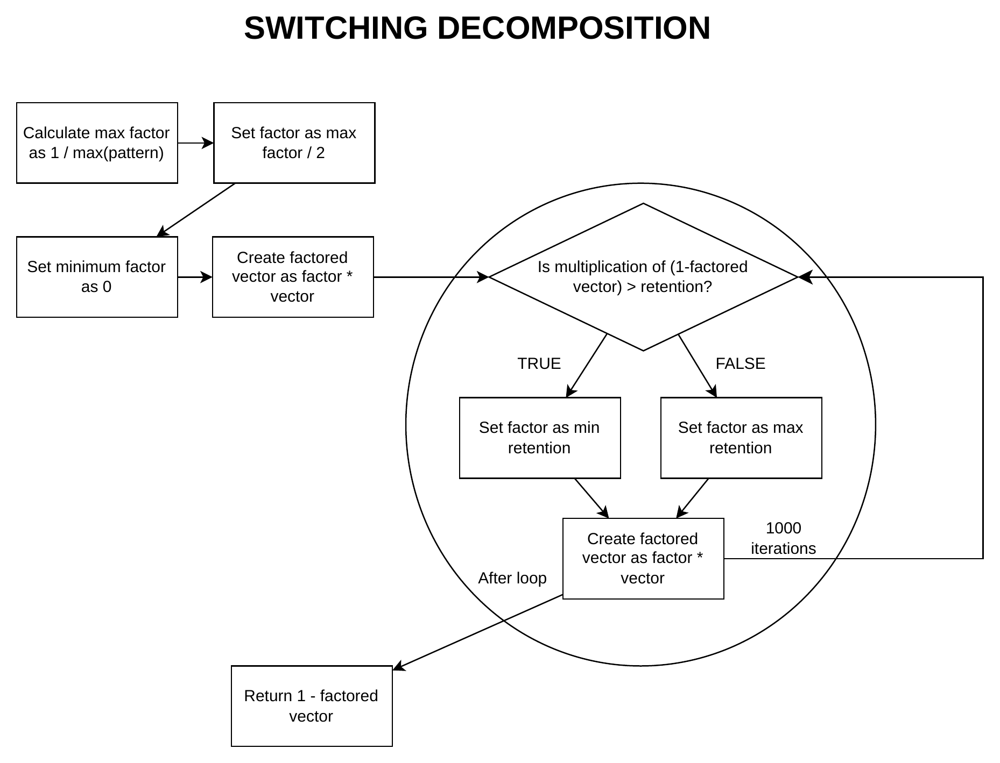
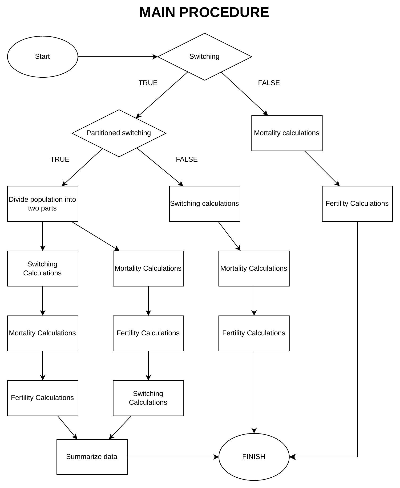
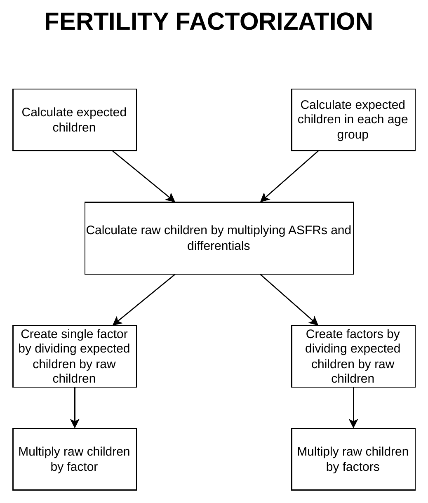
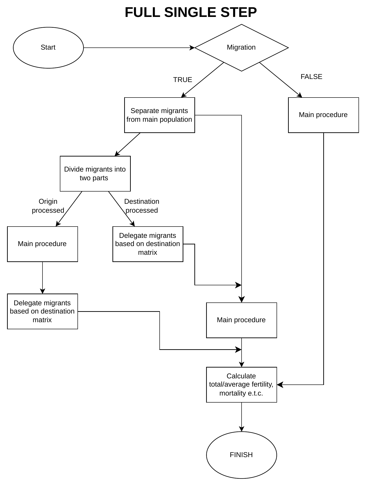

# Inner Workings

This vignette explains the internal structure of the two core R5
reference class objects and four key algorithms of the MRC package, each
algorithm illustrated by a flow diagram extracted from the package’s
design document.

For the user-facing workflow that drives these internals, see
[Conducting an MRC
Projection](https://caspar-pl.github.io/measuringreligiouschange/articles/conducting-projections.md).

------------------------------------------------------------------------

## 1 Object structure

### `Country_object`

One `Country_object` instance is created per country by
`object_loader()` inside
[`create_country_list()`](https://caspar-pl.github.io/measuringreligiouschange/reference/create_country_list.md).
It carries all demographic inputs, projection settings, and accumulated
outputs for a single country throughout the full projection lifetime.

**Identity fields**

| Field | Type | Description |
|----|----|----|
| `name` | character | Country name |
| `code` | numeric | ISO 3166-1 numeric country code |
| `region` | character | World region the country belongs to |
| `year` | numeric | Current projection year; advances by 5 at every step |
| `period` | character | Current five-year period label used in output tables (e.g. `"2020-2025"`) |

**Input data fields**

| Field | Type | Description |
|----|----|----|
| `structure_data` | list of matrices | Population by age group, sex, and religion. Each list element is a 40 × *n_religions* matrix keyed by year label. Before projection only the starting year is present; each step appends a new entry. |
| `mortality_rates` | matrix | Age- and sex-specific survival ratios. 42 rows (21 male + 21 female age groups, including age 0); one column per projection period. |
| `age_specific_fertility_rates` | matrix | Total-population ASFRs. Rows = projection periods; columns = fertile age groups. |
| `fertility_differentials` | list | Per-period matrices of religion-specific fertility multipliers. A value of 1.0 means the religion matches the national ASFR; values above / below indicate higher / lower relative fertility. |
| `sex_ratio` | numeric vector | Fraction of male births for each projection period. |
| `switching_matrices_list` | list | Decomposed switching probability matrices — one 40 × *n_religions* matrix per origin religion. Row *j*, column *k* gives the proportion of people in age–sex group *j* of origin religion *i* who end up in religion *k*. |
| `outmigration_rates` | list | Out-migration rate matrices by period. |
| `destination_matrix` | matrix | Share of emigrants directed to each destination country, by sex and religion. |
| `start_fertility_group` | numeric | Index of the first female age group included in fertility calculations (default 3, corresponding to age 10–14). |
| `combined_fertility_factorization` | logical | Controls the factorisation path in `fertility_step()`. `TRUE` (default) applies one global factor across all fertile age groups; `FALSE` normalises each age group independently. |

**Output data fields** — accumulated across steps by
`calculate_total_previous()`

| Field | Type | Description |
|----|----|----|
| `previous_mortality` | data.table | Deaths by age, sex, religion, and period. See *Exporting Projection Results* vignette for column details. |
| `previous_fertility` | data.table | Births by fertile age group, religion, and period. |
| `previous_asfr` | data.table | Age-specific fertility rates; rows with `Mother_age_group == "TFR"` contain the period total. |
| `previous_fertility_exposure` | data.table | Female population used as the ASFR denominator. |
| `previous_switching` | data.table | Switching flows from each origin religion to each destination religion. |
| `previous_immigration` | data.table | Immigrant flows arriving at this country from each origin. |
| `previous_emigration` | data.table | Emigrant flows leaving this country for each destination. |

**Technical fields**

| Field | Description |
|----|----|
| `temp` | Scratch space used during projection steps; not intended for direct access. |
| `emigration_list` | Internal buffer accumulating emigrants by destination during step 1 of the migration loop. |
| `projection_owner` | Name of the `Projection_object` that has claimed this country. An empty string means the country is unclaimed. Prevents the same country list from being reused across multiple projections. |

------------------------------------------------------------------------

### `Projection_object`

One `Projection_object` is assembled by
[`create_projection_object()`](https://caspar-pl.github.io/measuringreligiouschange/reference/create_projection_object.md)
and validated by
[`variants_loader()`](https://caspar-pl.github.io/measuringreligiouschange/reference/variants_loader.md).
It acts as the top-level container for an entire projection scenario —
holding the list of country objects, the global settings, and pointers
to region aggregates.

**Configuration fields**

| Field | Type | Description |
|----|----|----|
| `projection_name` | character | Unique name of the scenario; used as the default output folder name. |
| `steps` | numeric | Number of 5-year projection periods to simulate. |
| `migration` | logical | Whether migration (emigration and immigration) is applied. |
| `switching` | logical | Whether religious switching is applied. |
| `switching_type` | numeric | `1` = partitioned (split half–half); `2` = all switching before demographic processes. |
| `no_diff` | logical | If `TRUE`, all religions use the same aggregate ASFR (no fertility differentials). |
| `post_switch` | logical | If `FALSE` (default), switched individuals remain in the general population and may switch again in subsequent steps. If `TRUE`, they are moved into separate `*_post_switch` output columns and excluded from further switching. |
| `light_migration` | logical | If `TRUE`, migration output is collapsed to period totals rather than age–sex breakdowns. |
| `light_switching` | logical | If `TRUE`, switching output is collapsed to period totals. |
| `resolved` | logical | Becomes `TRUE` after [`project()`](https://caspar-pl.github.io/measuringreligiouschange/reference/project.md) completes; prevents re-projection of the same object. |

**Container fields**

| Field | Type | Description |
|----|----|----|
| `country_object_list` | list | Named list of `Country_object` instances, one per country. Keys follow the pattern `"c840"` for ISO code 840. |
| `region_object_list` | list | Named list of `Region_object` instances. Populated after [`project()`](https://caspar-pl.github.io/measuringreligiouschange/reference/project.md) when `save_totals = TRUE`. |

------------------------------------------------------------------------

## 2 The loader — `Loader.R`

`Loader.R` contains every function involved in transforming the raw
`base_data_list` into fully populated `Country_object` instances. The
public entry point is
[`create_country_list()`](https://caspar-pl.github.io/measuringreligiouschange/reference/create_country_list.md);
all other functions are internal.

### `base_data_list` slot reference

`base_data_list` is a numbered list. The table below shows which slot is
consumed by which loader function.

| Slot | Contents | Used by |
|----|----|----|
| `[[1]]` | Age-specific fertility rates (ASFR) by country and period | `object_loader()` → `age_specific_fertility_rates` |
| `[[2]]` | Religion-specific fertility differentials by country and age group | `object_loader()` → `fertility_differentials` |
| `[[3]]` | Migration destination-share matrix (origin × destination country) | `migration_limit_check()`, `object_loader()` → `destination_matrix` |
| `[[4]]` | Out-migration rates by country, sex, age, and period | `object_loader()` → `outmigration_rates` |
| `[[5]]` | Fraction of boys at birth by country and period | `object_loader()` → `sex_ratio` |
| `[[6]]` | Population counts by country, sex, and age group | `structure_data_adjustment()` |
| `[[7]]` | Religious composition shares by country, age group, and sex | `structure_data_adjustment()` |
| `[[8]]` | Survival ratios (survivability) by country, sex, and age | `object_loader()` → `mortality_rates` |
| `[[9]]` | Religious switching retention rates by country, sex, and religion | `object_loader()` → `switching_matrices_list` |
| `[[10]]` | Country registry (`info_variants`): names, ISO codes, and region labels | `country_info_adjustment()` |

------------------------------------------------------------------------

### Processing pipeline inside `create_country_list()`

    base_data_list
        │
        ├─ migration_limit_check()          validate [[3]] vs [[10]]
        │       ├─ "error"   → stop
        │       ├─ "rescale" → renormalise destination rows to sum to 1
        │       └─ "ignore"  → proceed with missing destinations
        │
        ├─ country_info_adjustment()        [[10]] → [[12]]
        │       sort by ISO code, add "c840"-style key column
        │
        ├─ structure_data_adjustment()      [[6]] × [[7]] → [[13]]
        │       multiply population counts by religion-share differentials;
        │       optionally append zero post-switch columns
        │
        └─ for each country_code in [[12]]:
                object_loader()

------------------------------------------------------------------------

### `migration_limit_check()`

Compares the number of rows in `info_variants` (\[\[10\]\]) to the
number of destination-country columns in the migration matrix
(\[\[3\]\]). When the matrix covers more countries than the projection
will model, emigrants sent to the excluded countries would effectively
disappear.

- **`"error"`** — halts with an informative message.
- **`"rescale"`** — subsets the destination matrix to the modelled
  countries and renormalises each row so destination shares sum to 1,
  preserving the relative distribution of emigrants among the included
  destinations.
- **`"ignore"`** — proceeds without adjustment; the missing probability
  mass is silently discarded.

------------------------------------------------------------------------

### `country_info_adjustment()`

Selects the first three columns of `info_variants` (country name, ISO
code, region), sorts rows by ISO code, and appends a fourth column of
string keys in the format `"c840"` (a `"c"` prefix followed by a
zero-padded three-digit code). These string keys become the names of
`country_object_list` so that a specific country can be accessed as
`obj$country_object_list[["c840"]]`.

------------------------------------------------------------------------

### `structure_data_adjustment()`

Produces the initial `structure_data[[1]]` matrix by combining two
sources:

1.  **Population counts** (\[\[6\]\]) — one row per country × sex
    combination, columns are 20 five-year age groups.
2.  **Religion-share differentials** (\[\[7\]\]) — one row per country ×
    sex × age group, columns are religion-specific proportions.

The function sorts both tables to a canonical order (country ascending,
males before females), expands the population counts into a flat vector,
and multiplies element-wise by the share differentials. The result is a
40 × *n_religions* matrix (20 male rows then 20 female rows) per
country.

When `post_switch = TRUE`, *n_religions* zero columns named
`"Christians_post_switch"`, `"Muslims_post_switch"`, etc. are appended,
doubling the column count. These are populated during the projection by
`switching_step()`.

------------------------------------------------------------------------

### `object_loader()`

Creates one `Country_object` per call. It filters every demographic
dataset to the target country code, transforms each into the shape
expected by the corresponding `Country_object` field, and then calls
`Country_object$new()`.

The transformation steps are:

1.  **Structure data** — the pre-built flat matrix is filtered to one
    country; row names are set to `"males 0-4"`, `"females 0-4"`, etc.
2.  **ASFR** — filtered and pivoted: rows become projection periods,
    columns become fertile age groups. Stored in
    `age_specific_fertility_rates`.
3.  **Fertility differentials** — filtered; the first list element is
    named with the starting period label (e.g. `"2020-2025"`).
4.  **Sex ratio** — filtered to a named numeric vector (one value per
    period).
5.  **Survivability** — filtered; row names are set to `"males 0"`,
    `"males 1-4"`, …, `"females 95+"`. The 42-row matrix is stored in
    `mortality_rates`.
6.  **Switching** — filtered and passed through `final_decomposition()`,
    which calls `switching_matrix_creator()` (see Section 2) to convert
    raw retention rates into row-stochastic transition matrices. Stored
    as `switching_matrices_list`.
7.  **Destination matrix** — filtered; row names encode religion and
    sex.
8.  **Out-migration rates** — filtered and split by period into a named
    list of matrices stored in `outmigration_rates`.

After `Country_object$new()` returns, `error_check()` validates the
object.

------------------------------------------------------------------------

### `error_check()`

Runs six consistency checks on a freshly created `Country_object`:

| Check | Condition |
|----|----|
| `mortality_rates` dimensions | must have *n_age_groups* + 2 rows |
| `fertility_differentials` columns | must equal *n_religions* or 2 × *n_religions* |
| `sex_ratio` values | must lie in 
``` math
0, 1
```
 for every period |
| `outmigration_rates` dimensions | columns must equal *n_religions* or 2 × *n_religions* |
| `destination_matrix` rows | must equal 2 × *n_religions* or 4 × *n_religions* |
| `switching_matrices_list` row sums | must equal 1.0 within 1 × 10⁻⁸ |

Any failure increments an error counter and prints a diagnostic message.
If the total is non-zero the function calls
[`stop()`](https://rdrr.io/r/base/stop.html).

------------------------------------------------------------------------

### Country-list ownership lock

Once `object_loader()` registers a `Country_object` with a
`Projection_object`, the `projection_owner` field is set to the
projection’s name.
[`create_projection_object()`](https://caspar-pl.github.io/measuringreligiouschange/reference/create_projection_object.md)
checks this field on every country and raises an error if any are
already owned, preventing the same list from being shared between two
projections. To run a second scenario, call
[`create_country_list()`](https://caspar-pl.github.io/measuringreligiouschange/reference/create_country_list.md)
again from scratch.

------------------------------------------------------------------------

## 3 Switching decomposition — `switching_matrix_creator()`



Before a projection runs, the raw switching patterns supplied in
`base_data_list` must be converted into proper row-stochastic matrices
(where each row sums to 1 and no religion can receive more switchers
than it retains). This is done by `switching_matrix_creator()` in
`data_adjustment.R` via a binary-search loop.

### Algorithm

1.  **Calculate max factor** — set the initial upper bound as
    `max_factor = 1 / max(pattern)`, which ensures that the scaled
    pattern does not exceed 1 in any entry.

2.  **Set factor = max_factor / 2** — start the binary search at the
    midpoint.

3.  **Set minimum factor = 0** — initialise the lower bound.

4.  **Create factored vector** — multiply the pattern by the current
    factor.

5.  **Check retention condition** (loop, up to 1 000 iterations): Is
    `prod(1 − factored_vector) > retention`?

    - **TRUE** — the product of survival probabilities exceeds the
      required retention rate, meaning the switching-out probability is
      too low. Set `factor = min_retention` and recompute the factored
      vector.
    - **FALSE** — the product is at or below the required retention
      rate. Set `factor = max_retention` and recompute.

    After each iteration the loop rechecks the condition. When the
    condition is satisfied stably (or after 1 000 iterations) the loop
    exits.

6.  **Return `1 − factored_vector`** — the complement of the factored
    switching pattern gives the final **retention probability** for that
    religion and age–sex group. This value becomes the diagonal entry of
    the switching transition matrix; off-diagonal entries are derived
    from the factored pattern.

------------------------------------------------------------------------

## 4 Main procedure — `dem_proj_no_mig()`



`dem_proj_no_mig()` is called once per country per projection step when
migration is disabled. The first decision in the flow is whether
**partitioned switching** is active.

### Partitioned switching (switching_type = 1)

When partitioned switching is TRUE the current population is **split
into two equal halves**, each processed in a different order so that
neither switching nor mortality dominates:

- **Half A** (left branch): Switching Calculations → Mortality
  Calculations → Fertility Calculations
- **Half B** (right branch): Mortality Calculations → Fertility
  Calculations → Switching Calculations

The two halves are recombined after both branches complete, and the
combined result is passed to **Summarise data**
(`calculate_total_previous()`), which accumulates the period’s output
into the `previous_*` fields before the step ends.

### Non-partitioned (switching_type = 2)

When partitioned switching is FALSE, the demographic steps run in a
single fixed sequence on the full population:

    Mortality Calculations → Fertility Calculations → FINISH

Switching is not applied separately in this branch; it is assumed to
have been applied externally or is folded into the mortality step. The
flow then proceeds directly to FINISH.

------------------------------------------------------------------------

## 5 Fertility factorisation — `fertility_step()`



Religion-specific fertility differentials cause the raw sum of births
across religions to diverge from the national total implied by the
age-specific fertility rates (ASFRs). `fertility_step()` corrects this
by scaling the raw births with a factorisation step. The diagram shows
the two available paths, controlled by
`combined_fertility_factorization`.

### Shared input

Both paths begin by computing **raw children**:

    raw_children = mid-period_female_population × ASFRs × fertility_differentials

where `ASFRs` and `fertility_differentials` are extracted for the
current period.

### Path A — combined factorisation (`combined_fertility_factorization = TRUE`)

1.  **Calculate expected children** — sum the expected births implied by
    the aggregate ASFR across all fertile age groups and religions.
2.  Compute a **single factor**:
    `factor = expected_children / raw_children` (summed totals).
3.  **Multiply raw children by factor** — apply the single scalar to
    every religion and age group uniformly.

This preserves the relative fertility differentials between religions
while ensuring the national total matches the expected value.

### Path B — per-age-group factorisation (`combined_fertility_factorization = FALSE`)

1.  **Calculate expected children in each age group** — compute the
    age-group-specific expected births.
2.  Compute **per-age-group factors**: one factor per fertile age group,
    `factor[age] = expected[age] / raw[age]`.
3.  **Multiply raw children by factors** — each age group is scaled by
    its own factor independently.

This ensures that the marginal age-group totals each match their
expected values, at the cost of allowing the cross-religion totals
within an age group to deviate slightly from the aggregate differential
structure.

------------------------------------------------------------------------

## 6 Full single step — `project()`



[`project()`](https://caspar-pl.github.io/measuringreligiouschange/reference/project.md)
wraps `dem_proj_no_mig()` (or its migration equivalent) in an outer loop
over all projection steps. The first decision at each step is whether
**migration** is enabled.

### Migration = FALSE

The step calls the **Main procedure** (`dem_proj_no_mig()`) directly,
then immediately proceeds to **Calculate total / average fertility,
mortality etc.** (`calculate_total_previous()`), which closes the step.

### Migration = TRUE

The migration path has additional sub-steps before the main demographic
calculation:

1.  **Separate migrants from main population** — `outmigration_step()`
    applies out-migration rates to each country and removes emigrants
    from `structure_data`, storing them in `emigration_list` keyed by
    destination ISO code.

2.  **Divide migrants into two parts** — the emigrant population is also
    split for symmetric processing, mirroring the partitioned-switching
    logic.

3.  Two parallel flows handle the two migrant streams:

    - **Destination-processed** stream: emigrants are delegated to their
      destination countries via
      `push_immigration("destination_processed")`, adding them to each
      destination’s `structure_data`.
    - **Origin-processed** stream: the **Main procedure** is applied to
      the remaining resident population first, then a second delegation
      step (`push_immigration("origin_processed")`) distributes the
      post-demographic migrants.

4.  **Calculate total / average fertility, mortality etc.** —
    `calculate_total_previous()` accumulates all output tables and the
    step closes.
