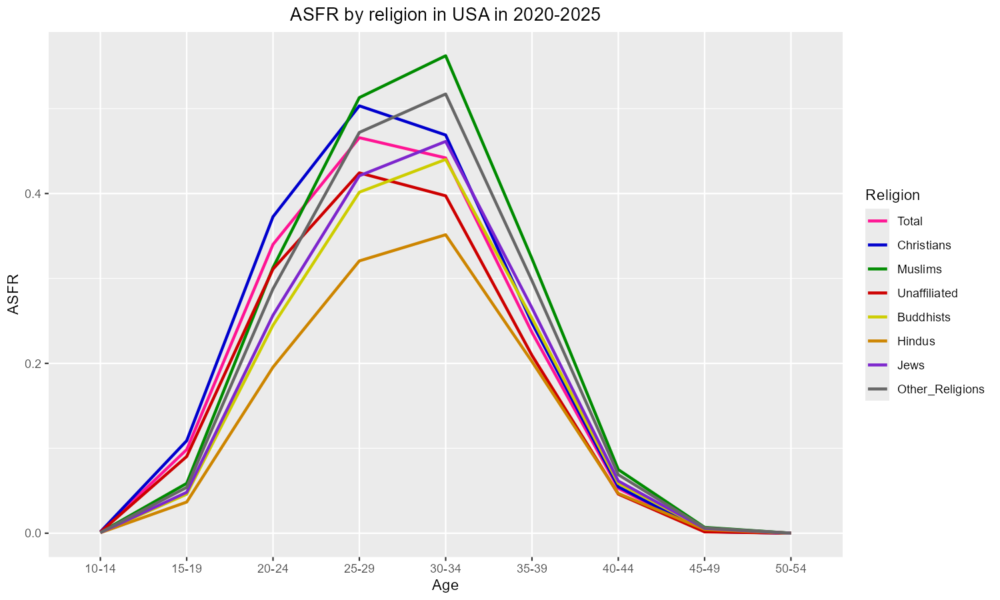

# Visualising MRC Projection Results

This vignette explains how to save and interpret MRC projection plots
using the two exported plotting workflows. For how to create and run a
projection, see [Conducting an MRC
Projection](conducting-projections.md). For CSV export, see [Exporting
Projection Results](exporting-results.md).

All example images below were generated from a full 11-step, 201-country
projection for the **United States (ISO 840)** with
`post_switch = TRUE`, `light_migration = TRUE`,
`light_switching = TRUE`, `switching_type = 1`, and `no_diff = FALSE`. A
second projection with `no_diff = TRUE` is used for the comparative
section. PNG files are embedded directly so the vignette renders
instantly.

------------------------------------------------------------------------

## 1 Country-level plots — `save_plots_all()`

[`save_plots_all()`](../reference/save_plots_all.md) generates every
applicable plot variant for every country and saves them as PDF files
(one per country, or a single combined file).

``` r

library(measuringreligiouschange)

save_plots_all(
  obj_normal,

  # ── Output location ────────────────────────────────────────────────────
  folder = "output/normal", # directory to write into; created if absent.
  # Defaults to the projection's name.
  single_file = FALSE, # FALSE → one PDF per country; TRUE → one combined PDF.
  order_by_name = FALSE, # FALSE → order by ISO code; TRUE → alphabetical.

  # ── Content switches ───────────────────────────────────────────────────
  demographic_plots = TRUE, # variants 1, 2, 3, 4, 5, 6, 7, 8, 14 — see below.
  switching_plots = TRUE, # variants 12 and 13.
  # Omit to inherit from the projection's setting.
  migration_plots = TRUE, # variants 9, 10, and 11.
  # Omit to inherit from the projection's setting.

  # ── Post-switch display ────────────────────────────────────────────────
  show_post_switch = TRUE, # TRUE → show original and post-switch populations
  # separately; FALSE → merge them into one series.

  # ── Colour palettes ────────────────────────────────────────────────────
  plot_colors = c( # one colour per base religion (7 required)
    "blue3", "green4", "red3", "yellow3", "orange3", "purple3", "grey40"
  ),
  plot_switching_colors = c( # one colour per base + post-switch religion (14)
    "blue3", "green4", "red3", "yellow3", "orange3", "purple3", "grey40",
    "darkblue", "darkgreen", "red4", "yellow4", "orange4", "purple4", "grey30"
  ),
  progress_bar = FALSE
)
```

### Plot variants by flag

The three content switches control which variant groups are produced:

**`demographic_plots = TRUE`**

| Variant | Indicator | Notes |
|----|----|----|
| 14 | Population summary table | Shares by religion and period |
| 1 | Total population | All religions combined |
| 2 | Population by religion | One panel per religion |
| 3 | Stacked population structure | Religious shares over time |
| 4 | Population pyramid | Saved at three periods: first, middle, last |
| 5 | Total fertility rate (TFR) | By religion |
| 6 | Age-specific fertility rates | Saved at three periods |
| 7 | Births | By religion |
| 8 | Deaths | By religion |

**`migration_plots = TRUE`**

| Variant | Indicator                         |
|---------|-----------------------------------|
| 9       | In- and out-migration over time   |
| 10      | Emigrant composition by religion  |
| 11      | Immigrant composition by religion |

**`switching_plots = TRUE`**

| Variant | Indicator                     | Notes                  |
|---------|-------------------------------|------------------------|
| 12      | Religious retention by sex    |                        |
| 13      | Religious retention over time | One panel per religion |

### Example output — USA (code 840)

**Variant 14 — Population summary table**


Variant 14: Population share summary table for the USA across all
projection periods.

**Variant 1 — Total population**


Variant 1: Total projected population of the USA (2020–2075).

**Variant 2 — Population by religion** (Christians)


Variant 2: USA population — Christians.

**Variant 3 — Population structure**


Variant 3: Stacked population structure of the USA.

**Variant 4 — Population pyramid** (period 6 ≈ 2050)


Variant 4: Population pyramid of the USA at 2050.

**Variant 5 — Total fertility rate**


Variant 5: TFR of the USA by religious group.

**Variant 6 — ASFR** (period 1, 2020–2025)



Variant 6: ASFR of the USA in 2020–2025.

**Variant 7 — Births**


Variant 7: Projected births in the USA by religion.

**Variant 8 — Deaths**


Variant 8: Projected deaths in the USA by religion.

**Variant 9 — Migration**


Variant 9: In- and out-migration flows for the USA.

**Variant 10 — Emigrant composition**


Variant 10: Religious composition of emigrants from the USA.

**Variant 11 — Immigrant composition**


Variant 11: Religious composition of immigrants to the USA.

**Variant 12 — Retention by sex** (post-switch populations merged)


Variant 12: Religious retention and switching by sex in the USA.

**Variant 13 — Retention over time** (Christians)


Variant 13: Religious retention over time in the USA — Christians.

------------------------------------------------------------------------

## 2 Region-level plots — `save_plots_regions_all()`

[`save_plots_regions_all()`](../reference/save_plots_regions_all.md)
accepts the same arguments as
[`save_plots_all()`](../reference/save_plots_all.md) and generates the
same variant groups aggregated to world regions. It requires
`save_totals = TRUE` in [`project()`](../reference/project.md).

``` r

save_plots_regions_all(
  obj_normal,
  folder = "output/normal_regions",
  single_file = FALSE,
  show_post_switch = TRUE,
  demographic_plots = TRUE, # variants 1–8 and 14 aggregated to regions
  switching_plots = TRUE, # variants 12–13
  migration_plots = TRUE, # variants 9–11
  plot_colors = c("blue3", "green4", "red3", "yellow3", "orange3", "purple3", "grey40"),
  plot_switching_colors = c(
    "blue3", "green4", "red3", "yellow3", "orange3", "purple3", "grey40",
    "darkblue", "darkgreen", "red4", "yellow4", "orange4", "purple4", "grey30"
  ),
  progress_bar = FALSE
)
```

------------------------------------------------------------------------

## 3 Comparative plots — `plot_comparative()` and `save_plots_comparative_all()`

Comparative functions overlay two or more projection objects on the same
axes.

### `plot_comparative()` — single plot, returned as a ggplot object

``` r

p <- plot_comparative(
  projection_objects = list(obj_normal, obj_nodiff),
  # List of resolved projection objects.
  # Legend labels come from each object's projection name.

  country = 186L, # Integer index into country_object_list.

  type = 1L, # Comparative plot type (1–10); see table below.

  religion = 1L, # Religion index used by type-specific plots
  # (types 2, 3, 10). Ignored by types that aggregate
  # all religions (types 1, 4, 5, 6, 7, 8, 9).

  plot_colors = c( # 14-element palette: 7 base religions + 7 post-switch.
    "blue3", "green4", "red3", "yellow3", "orange3", "purple3", "grey40",
    "darkblue", "darkgreen", "red4", "yellow4", "orange4", "purple4", "grey30"
  )
)
# ggsave("comparison.png", p, width = 10, height = 6, dpi = 150)
```

### `save_plots_comparative_all()` — saves all types for every country

``` r

save_plots_comparative_all(
  projection_objects = list(obj_normal, obj_nodiff),
  # List of two or more resolved projection objects.

  folder = "output/comparative",
  # Output directory; created if absent.

  single_file = FALSE, # FALSE → one PDF per country; TRUE → combined PDF.

  demographic_plots = TRUE, # comparative types 1, 2, 3, 4, 5, 6
  migration_plots = TRUE, # comparative types 7, 8, 9
  switching_plots = TRUE, # comparative type 10
  # Omit each to inherit from the first object.

  plot_colors = c(
    "blue3", "green4", "red3", "yellow3", "orange3", "purple3", "grey40",
    "darkblue", "darkgreen", "red4", "yellow4", "orange4", "purple4", "grey30"
  ),
  progress_bar = FALSE
)
```

### Comparative plot types by flag

**`demographic_plots = TRUE`**

| Type | Indicator                    | Notes                  |
|------|------------------------------|------------------------|
| 1    | Total population             | All religions combined |
| 2    | Population by religion       | One panel per religion |
| 3    | Population structure         | One panel per religion |
| 4    | Population pyramid           |                        |
| 5    | Total fertility rate         |                        |
| 6    | Age-specific fertility rates |                        |

**`migration_plots = TRUE`**

| Type | Indicator          |
|------|--------------------|
| 7    | Births by religion |
| 8    | Emigration         |
| 9    | Immigration        |

**`switching_plots = TRUE`**

| Type | Indicator       | Notes                  |
|------|-----------------|------------------------|
| 10   | Switching flows | One panel per religion |

### Example output — USA, normal vs no-differential fertility

**Type 1 — Total population**


Comparative type 1: Total population — normal vs no-diff (USA).

**Type 2 — Population by religion** (Christians)


Comparative type 2: Population — normal vs no-diff (USA, Christians).

**Type 4 — Population pyramid**


Comparative type 4: Population pyramid — normal vs no-diff (USA).

**Type 5 — TFR**


Comparative type 5: TFR — normal vs no-diff (USA).

**Type 7 — Births**


Comparative type 7: Births — normal vs no-diff (USA).

**Type 8 — Emigration**


Comparative type 8: Emigration — normal vs no-diff (USA).

**Type 9 — Immigration**


Comparative type 9: Immigration — normal vs no-diff (USA).

**Type 10 — Switching flows** (Christians)


Comparative type 10: Switching flows — normal vs no-diff (USA,
Christians).
